# Лабораторная работа №6

## Система контроля версий


**Выполнил:** студент группы 4516 Ростовцев А.С.


**Репозиторий:** https://github.com/rostovcevartem209/LR6


## Цель работы


Изучить базовые возможности Git и получить опыт работы с локальным и удалённым репозиториями.


## Ход выполнения работы


### 1. Создание личной копии репозитория


На GitHub создана копия репозитория Kurtyanik/LR6 с помощью Fork.

Скопированы обе ветки: master и branch1.


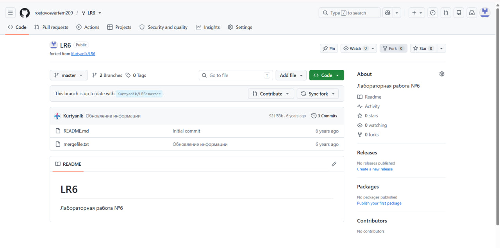


### 2. Проверка Git и настройка автора


Проверена установленная версия Git: 2.52.0.windows.1.

Настроены имя автора в формате «Группа Фамилия И.О.» и электронная почта.


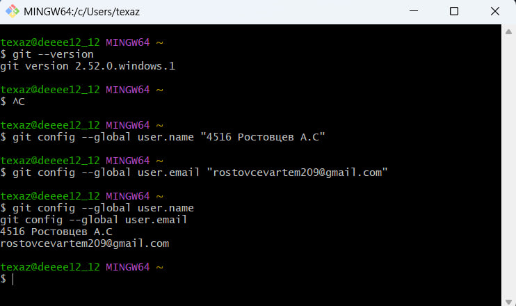


### 3. Клонирование репозитория


Личный репозиторий склонирован на компьютер.

Проверены состояние рабочей папки и доступные ветки.


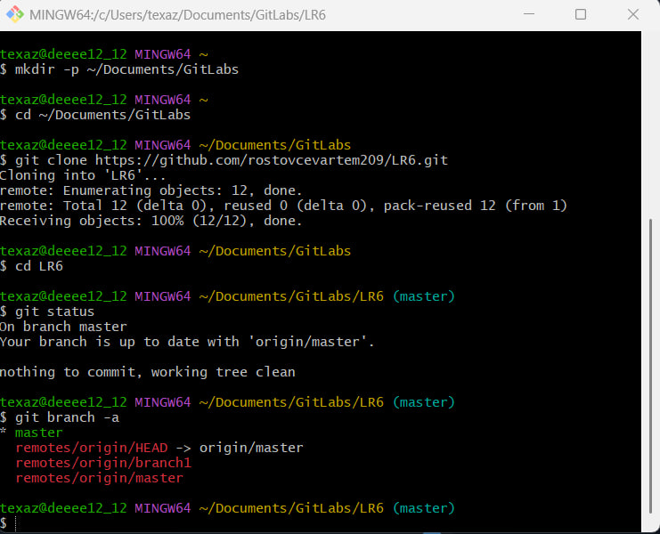


### 4. Получение изменений с GitHub


Через веб-интерфейс GitHub создан файл github-file.txt.

Изменение зафиксировано в ветке master.


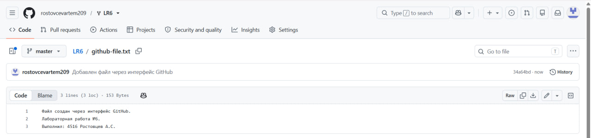


Командой git pull origin master изменения получены в локальный репозиторий.

Проверены содержимое файла и состояние рабочей папки.


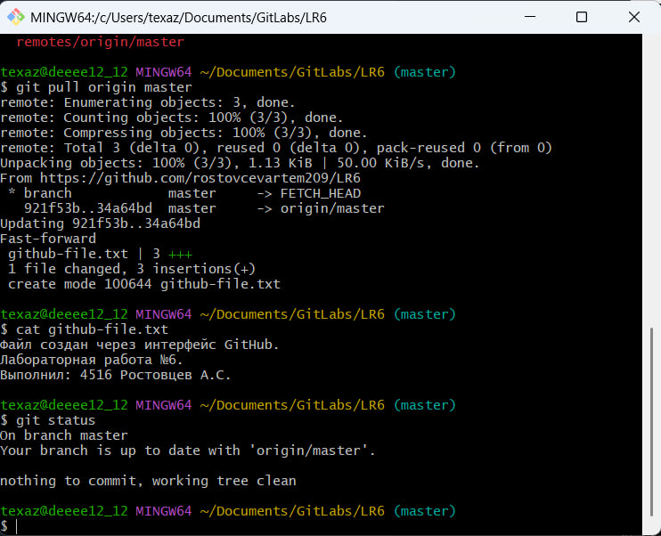


### 5. Просмотр истории веток


Создана локальная ветка branch1 на основе origin/branch1.

Просмотрены история каждой ветки и общий граф коммитов.


При первом просмотре истории master была допущена опечатка в параметре команды.

После исправления команда выполнена успешно.


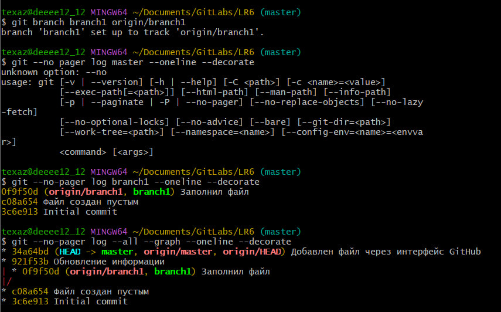


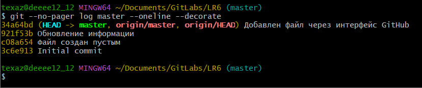


### 6. Просмотр последних изменений


С помощью git show просмотрены последние коммиты веток master и branch1.

Командой git diff выполнено сравнение файла mergefile.txt между ветками.


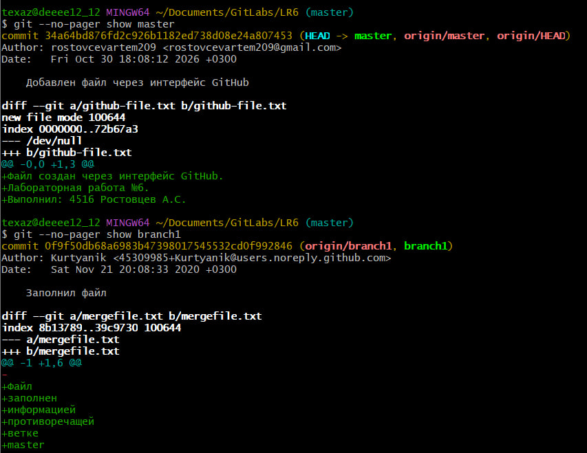


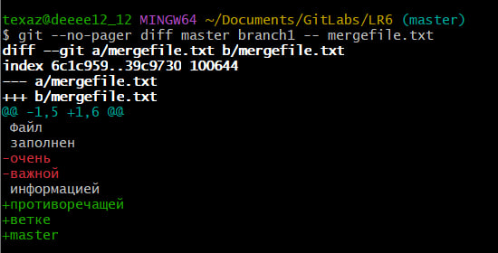


### 7. Слияние веток и разрешение конфликта


В ветке master выполнена команда git merge branch1.

Возник конфликт содержимого файла mergefile.txt, поскольку обе ветки изменили один участок файла.


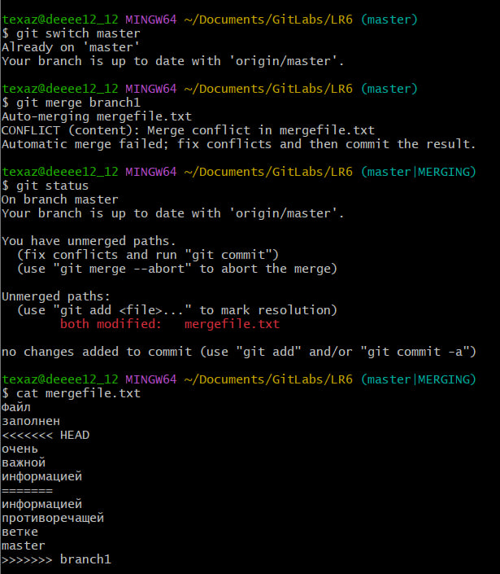


Файл открыт в Блокноте. Конфликт разрешён вручную:

удалены маркеры конфликта и сохранён согласованный вариант содержимого.

Исправленный файл добавлен в индекс, затем создан коммит слияния 715a0ed.


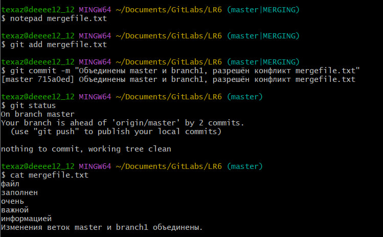


### 8. Удаление побочной ветки


После успешного слияния локальная ветка branch1 удалена командой git branch -d branch1.

Её коммиты сохранились в истории master.


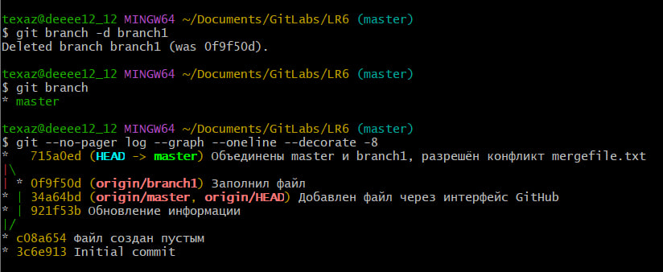


### 9. Последовательная фиксация изменений


Создан файл progress.txt. Выполнены три отдельных коммита с комментариями:


- 04112ae — создан файл с ходом выполнения лабораторной;

- 060c295 — добавлена информация о слиянии веток;

- 884dfc6 — добавлена временная строка для последующего отката.


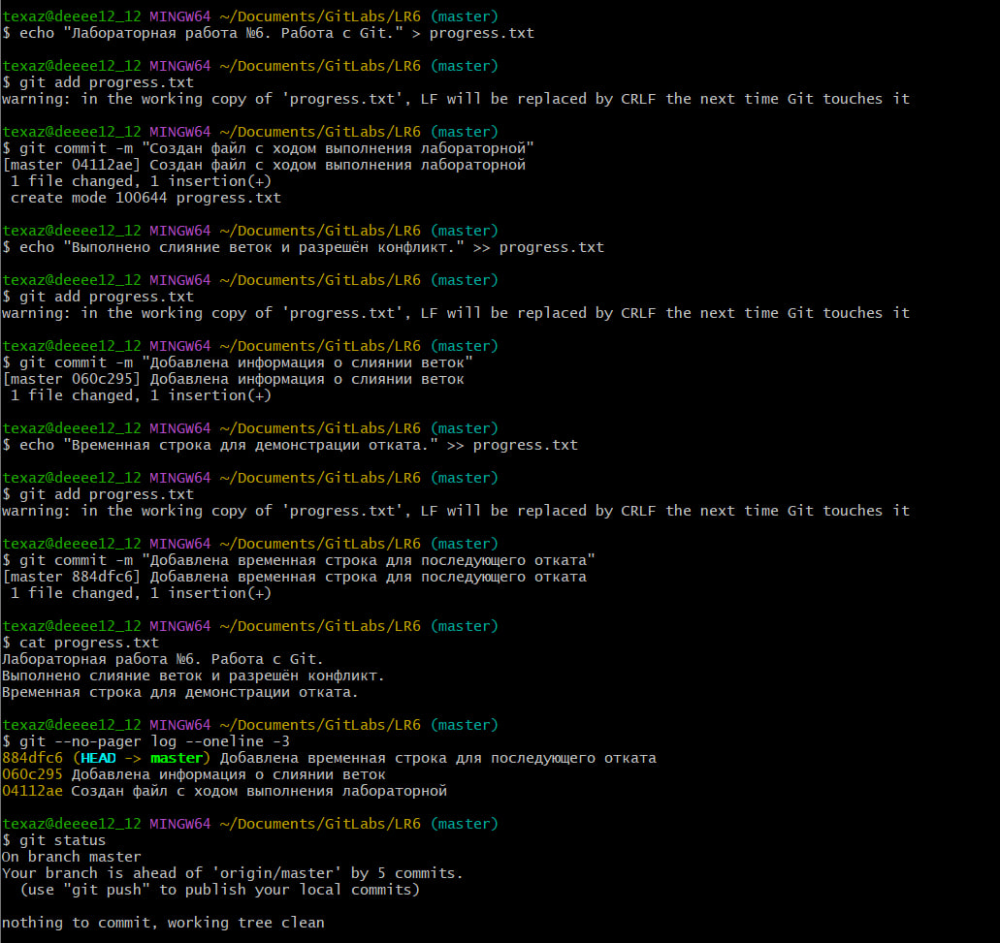


### 10. Откат коммита


Командой git revert --no-edit HEAD отменено последнее изменение.

Создан коммит cd8590c, удаляющий временную строку из progress.txt.

Предыдущие две строки файла сохранены. История коммитов не переписана.


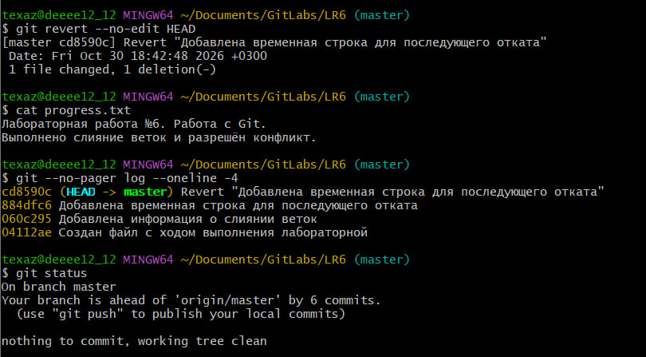


### 11. Создание ветки и оформление отчёта


Создана отдельная ветка report.

Отчёт оформляется в README.md с использованием Markdown.

Скриншоты размещены в папке screenshots.

Изменения отчёта фиксируются отдельными коммитами с комментариями.


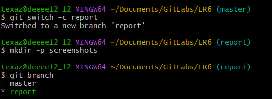


## Журнал команд


Ниже приведены команды выполненных этапов без результатов их выполнения.

В настройке почты использован адрес, указанный в аккаунте GitHub.


```bash

git --version

git config --global user.name "4516 Ростовцев А.С"

git config --global user.email "rostovcevartem209@gmail.com"

git config --global user.name

git config --global user.email


mkdir -p ~/Documents/GitLabs

cd ~/Documents/GitLabs

git clone https://github.com/rostovcevartem209/LR6.git

cd LR6

git status

git branch -a


git pull origin master

cat github-file.txt

git status


git branch branch1 origin/branch1

git --no pager log master --oneline --decorate

git --no-pager log branch1 --oneline --decorate

git --no-pager log --all --graph --oneline --decorate

git --no-pager log master --oneline --decorate


git --no-pager show master

git --no-pager show branch1

git --no-pager diff master branch1 -- mergefile.txt


git switch master

git merge branch1

git status

cat mergefile.txt

notepad mergefile.txt

git add mergefile.txt

git commit -m "Объединены master и branch1, разрешён конфликт mergefile.txt"

git status

cat mergefile.txt


git branch -d branch1

git branch

git --no-pager log --graph --oneline --decorate -8


echo "Лабораторная работа №6. Работа с Git." > progress.txt

git add progress.txt

git commit -m "Создан файл с ходом выполнения лабораторной"


echo "Выполнено слияние веток и разрешён конфликт." >> progress.txt

git add progress.txt

git commit -m "Добавлена информация о слиянии веток"


echo "Временная строка для демонстрации отката." >> progress.txt

git add progress.txt

git commit -m "Добавлена временная строка для последующего отката"


cat progress.txt

git --no-pager log --oneline -3

git status


git revert --no-edit HEAD

cat progress.txt

git --no-pager log --oneline -4

git status


git switch -c report

mkdir -p screenshots

git branch

explorer .

ls screenshots


notepad README.md

git add README.md screenshots

git commit -m "Начат отчёт: добавлены первые этапы работы и скриншоты"

git status

```

## Форматированная история коммитов

История получена командой:

```bash
git --no-pager log --all --date=short --pretty=format:"%h | %ad | %an | %s"
```

Формат строки: сокращённый хэш | дата | автор | комментарий.

```text
a1b3640 | 2026-10-30 | 4516 Ростовцев А.С | Дополнен отчёт: слияние, откат и журнал команд
a40a29a | 2026-10-30 | 4516 Ростовцев А.С | Начат отчёт: добавлены первые этапы работы и скриншоты
cd8590c | 2026-10-30 | 4516 Ростовцев А.С | Revert "Добавлена временная строка для последующего отката"
884dfc6 | 2026-10-30 | 4516 Ростовцев А.С | Добавлена временная строка для последующего отката
060c295 | 2026-10-30 | 4516 Ростовцев А.С | Добавлена информация о слиянии веток
04112ae | 2026-10-30 | 4516 Ростовцев А.С | Создан файл с ходом выполнения лабораторной
715a0ed | 2026-10-30 | 4516 Ростовцев А.С | Объединены master и branch1, разрешён конфликт mergefile.txt
34a64bd | 2026-10-30 | rostovcevartem209 | Добавлен файл через интерфейс GitHub
921f53b | 2020-11-21 | Kurtyanik | Обновление информации
0f9f50d | 2020-11-21 | Kurtyanik | Заполнил файл
c08a654 | 2020-11-21 | Kurtyanik | файл создан пустым
3c6e913 | 2020-11-21 | Kurtyanik | Initial commit
```

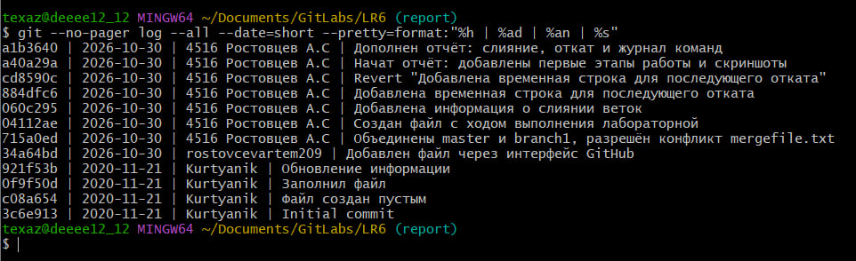

История приведена на момент перед финальной фиксацией отчёта.

## Продолжение журнала команд

```bash
notepad README.md
git add README.md
git commit -m "Дополнен отчёт: слияние, откат и журнал команд"
git status

git --no-pager log --all --date=short --pretty=format:"%h | %ad | %an | %s"

notepad README.md
git add README.md screenshots/15-formatted-history.jpg
git commit -m "Завершён отчёт: добавлены форматированная история и вывод"
git status
```

## Вывод

В ходе работы освоены клонирование репозитория, получение удалённых изменений,
просмотр истории и сравнение версий файлов. Выполнены слияние веток с ручным
разрешением конфликта, удаление объединённой локальной ветки и последовательная
фиксация изменений. Последнее изменение отменено с помощью git revert.
Отчёт оформлен в Markdown в отдельной ветке report.